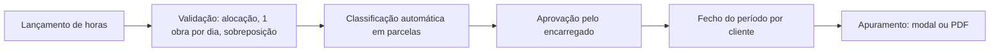
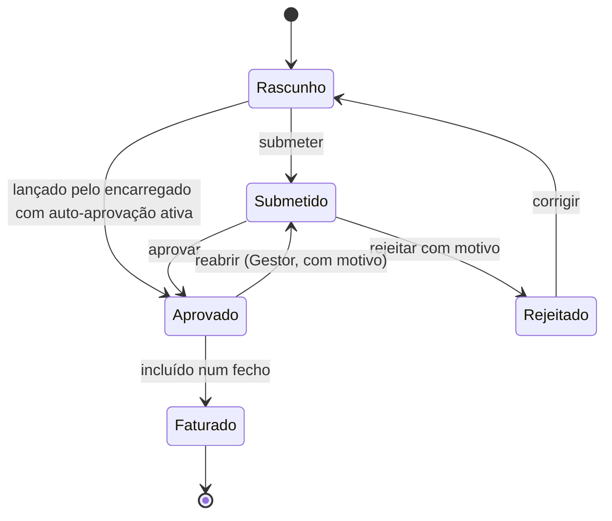
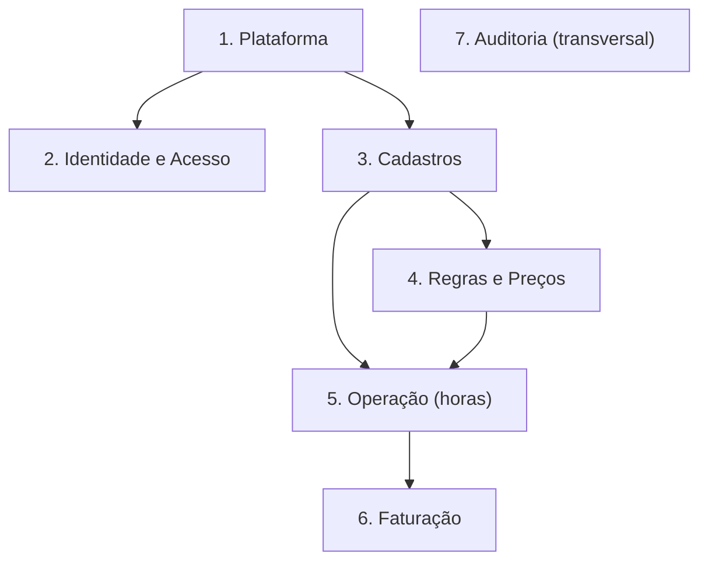
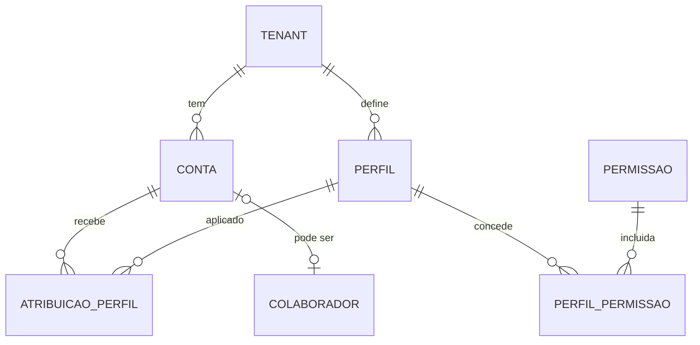
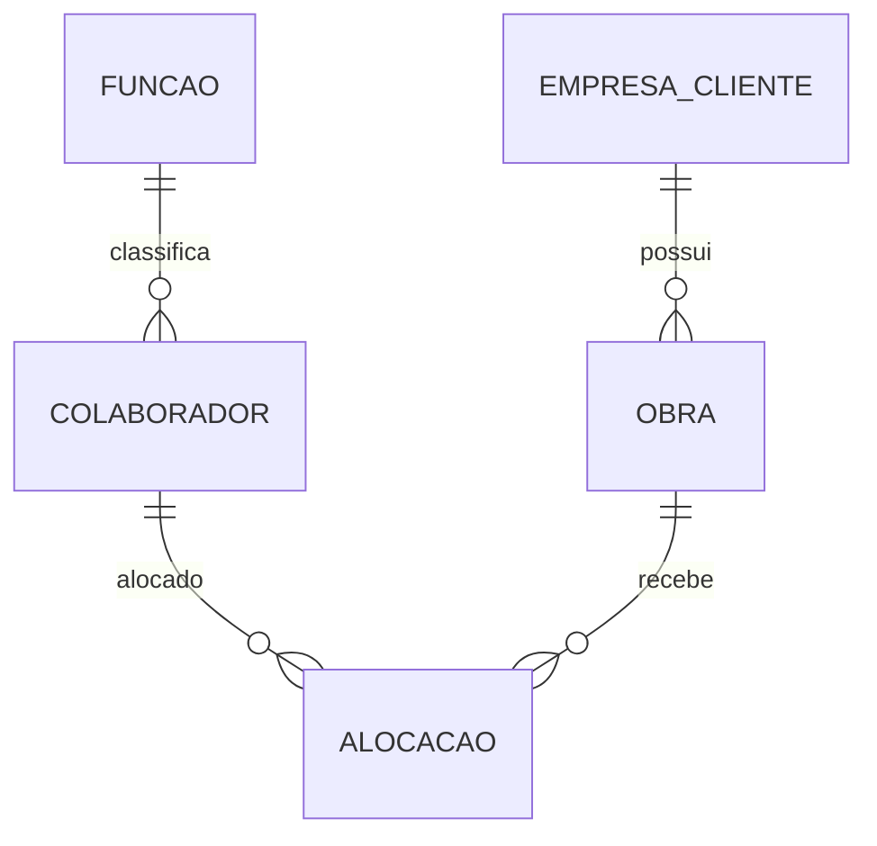
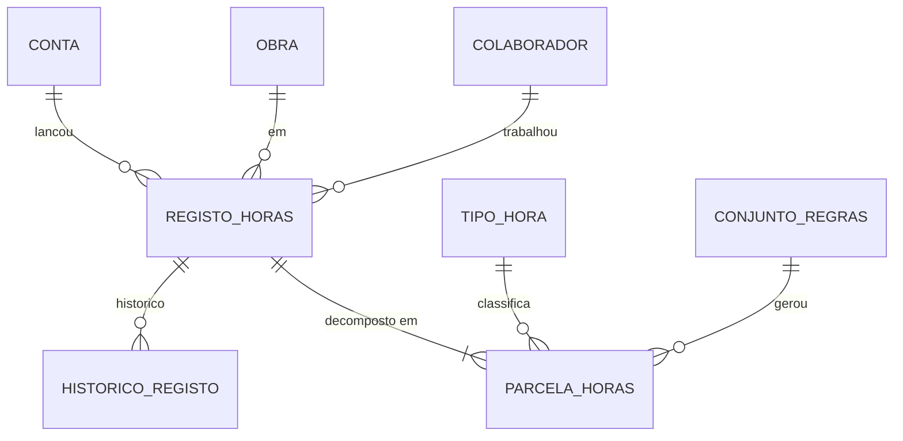
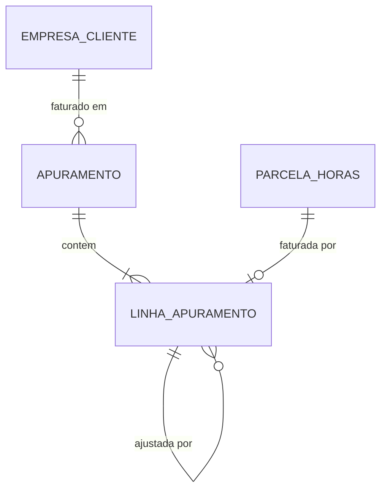

# Plano Conceitual — SaaS de Gestão de Horas e Apuramento de Faturação

> Produto SaaS multiempresa para **empresas de alocação de mão de obra**. A **FONSAT** é o primeiro cliente/piloto.
> Este documento descreve a ideia, o domínio e o modelo de dados. **Não define tecnologias.**

---

## 1. Visão do produto

Cada empresa de alocação (o **tenant**) tem um ambiente próprio e isolado, onde:

1. regista clientes (construtoras), obras e colaboradores;
2. lança as horas trabalhadas (o próprio colaborador ou o encarregado);
3. o sistema **classifica automaticamente** as horas (normal / extra / noturna / extra noturna);
4. o encarregado aprova;
5. a administração **fecha o período por cliente** e obtém um apuramento simples (modal ou PDF) que serve de base à fatura.

**Regra central (herdada da proposta):**

> Horas **registadas** ≠ horas **aprovadas** ≠ horas **faturadas**.
> Cada conceito tem uma entidade própria no banco.

---

## 2. Registo de decisões (resultado da entrevista)

| # | Tema | Decisão |
|---|------|---------|
| 1 | Objetivo | SaaS próprio; a FONSAT é o piloto; o MVP já nasce multiempresa |
| 2 | Fronteira do tenant | **Isolamento total**: contas, colaboradores, clientes e obras pertencem a um único tenant |
| 3 | Login | Username interno, único **dentro do tenant** (ex.: `joao.silva` @ `fonsat`), sem domínio de email real |
| 4 | Quem lança horas | Os dois modos (colaborador ou encarregado), configurável por tenant; fica sempre registado *de quem* são as horas e *quem lançou* |
| 5 | Perfis | 4 perfis fixos no MVP (Admin, Gestor, Encarregado, Colaborador), guardados como dados (Perfil → Permissões), com âmbito por tenant ou por obra |
| 6 | Acesso do cliente | Não existe no MVP; o modelo já o suporta (perfil "Cliente" com âmbito na empresa cliente) |
| 7 | Preços | Tabela de preços com vigência, por Função × Tipo de hora, resolvida em cascata (colaborador → função → obra → cliente) |
| 8 | Classificação | **Automática no MVP** |
| 9 | Regras | Só **limite diário** e **janela noturna**, ao nível do tenant. Sem feriados |
| 10 | Custo / margem | **Fora do produto**; o foco é só o valor faturado |
| 11 | Aprovação | Por registo, com ações em lote; estados com histórico |
| 12 | Correções | Antes do fecho: o registo pode ser reaberto, com motivo. Depois do fecho: **imutável**; corrige-se com um *ajuste* no período seguinte |
| 13 | Saída | Fecho por cliente + período; apuramento **o mais simples possível** (modal / PDF simples); sem emissão fiscal |
| 14 | Isolamento no banco | Banco partilhado com `tenant_id` obrigatório e isolamento imposto **pelo próprio banco** |
| 15 | Onboarding | **Self-service**: a empresa regista-se e o ambiente é criado automaticamente |
| 16 | Monetização | Gratuito, sem planos nem limites por agora |
| 17 | Auditoria / RGPD | Nada com histórico é apagado (só arquivado); auditoria genérica; dados pessoais anonimizáveis |
| 18 | Função | **Uma função fixa por colaborador** (copiada para o registo no momento do cálculo) |
| 19 | Várias obras no mesmo dia | **Proibido no MVP**: um colaborador só trabalha numa obra por dia |
| 20 | Detalhe das regras | Só limite diário; turnos podem atravessar a meia-noite e contam para o dia de início; janela noturna configurável |

---

## 3. Atores

| Ator | Camada | O que faz |
|------|--------|-----------|
| **Super-admin** (você) | Plataforma | Vê e suspende tenants; dá suporte (com acesso "entrar como" sempre auditado) |
| **Admin do tenant** | Tenant | Gere clientes, obras, colaboradores, funções, preços, regras, contas e configurações |
| **Gestor / Escritório** | Tenant | Reabre registos, fecha períodos e consulta apuramentos |
| **Encarregado** | Tenant (âmbito: obras) | Lança horas da equipa e aprova/rejeita registos das suas obras |
| **Colaborador** | Tenant (âmbito: próprio) | Lança e consulta as suas horas (se o tenant permitir) |
| *Cliente (futuro)* | Tenant (âmbito: empresa cliente) | Consulta/valida as horas das suas obras |

> [!NOTE]
> **Colaborador ≠ Conta de acesso.** O colaborador é a pessoa alocada e faturada, e existe sempre. A conta é opcional e serve apenas para entrar no sistema. Um colaborador pode ter horas faturadas sem nunca fazer login (o encarregado lança por ele). Um encarregado pode ser, ao mesmo tempo, conta e colaborador faturado.

---

## 4. Fluxos principais

### 4.1 Onboarding self-service

### 4.2 Ciclo operacional

### 4.3 Estados do registo de horas

- Cada transição gera uma linha de **histórico** (quem, quando, de/para, motivo, versão).
- A classificação é calculada como **pré-visualização** enquanto o registo é editável e fica **congelada** na aprovação.
- **Faturado** é terminal: correções só por **ajuste** (ver 6.6).

---

## 5. Modelo de dados conceitual

O modelo está organizado em **7 camadas**. Todas as tabelas, exceto as da Plataforma, têm `tenant_id`.

### 5.1 Plataforma (fora do tenant)

| Entidade | Razão de existir | Campos-chave |
|----------|------------------|--------------|
| **Tenant** | A empresa de alocação | id, slug (único global), nome, NIF, estado (ativo / suspenso / cancelado), fuso horário, moeda, criado_em |
| **ConfiguracaoTenant** | Comportamento configurável sem bifurcar código | tenant_id, modo_lancamento (colaborador / encarregado / ambos), auto_aprovar_lancamento_encarregado, regra_arredondamento |
| **ModuloTenant** | Feature flags por tenant (portal do cliente, regras por obra…) | tenant_id, modulo, ativo |
| **SuperAdmin** | As suas contas de plataforma (separadas das contas dos tenants) | id, email, hash_senha |

> [!TIP]
> Mesmo sem planos agora, guardar **módulos ativos por tenant** é o que permite lançar features gradualmente e, mais tarde, criar planos sem mexer no núcleo.

### 5.2 Identidade e acesso

| Entidade | Campos-chave | Notas |
|----------|--------------|-------|
| **Conta** | id, tenant_id, username, hash_senha, colaborador_id (opcional), ativa, ultimo_acesso | Único: (tenant_id, username) |
| **Perfil** | id, tenant_id, codigo, nome, sistema (s/n) | Os 4 perfis do MVP são semeados com `sistema = s` |
| **Permissao** | codigo (ex.: `horas.aprovar`, `periodo.fechar`) | Catálogo global |
| **PerfilPermissao** | perfil_id, permissao_codigo | |
| **AtribuicaoPerfil** | tenant_id, conta_id, perfil_id, tipo_ambito (tenant / obra / cliente), ambito_id | Ex.: Encarregado com âmbito na obra X |

### 5.3 Cadastros

| Entidade | Campos-chave |
|----------|--------------|
| **EmpresaCliente** | id, tenant_id, nome, NIF, contactos, ativa |
| **Obra** | id, tenant_id, cliente_id, nome, morada/localidade, data_inicio, data_fim, ativa |
| **Funcao** | id, tenant_id, nome (servente, pedreiro, eletricista…), ativa |
| **Colaborador** | id, tenant_id, funcao_id, nome, NIF, contactos, ativo, anonimizado_em |
| **Alocacao** | id, tenant_id, colaborador_id, obra_id, inicio, fim (opcional) |

### 5.4 Regras e preços

| Entidade | Campos-chave | Notas |
|----------|--------------|-------|
| **TipoHora** | id, tenant_id, codigo (NORMAL, EXTRA, NOTURNA, EXTRA_NOTURNA), nome | Semeado no onboarding. Cada minuto recebe exatamente um tipo |
| **ConjuntoRegras** | id, tenant_id, obra_id (opcional, futuro), valido_de, valido_ate, limite_diario_min, noturno_inicio, noturno_fim | MVP: só ao nível do tenant (`obra_id` vazio) |
| **TabelaPrecos** | id, tenant_id, cliente_id (opcional), obra_id (opcional), valido_de, valido_ate | Associada ao cliente **ou** à obra |
| **LinhaPreco** | id, tenant_id, tabela_id, tipo_hora_id, funcao_id (opcional), colaborador_id (opcional), preco_hora_centimos | |

**Resolução do preço (do mais específico para o mais genérico), para a data do registo:**

1. Linha com o **colaborador** na tabela da **obra**
2. Linha com a **função** na tabela da **obra**
3. Linha genérica (sem função) na tabela da **obra**
4. As mesmas três verificações na tabela do **cliente**
5. Sem preço → o registo fica marcado como **"sem preço"** e bloqueia o fecho (nunca fatura 0 € em silêncio)

> [!IMPORTANT]
> Não pode haver duas tabelas vigentes com sobreposição de datas para o mesmo alvo (cliente ou obra). Isto deve ser garantido **pelo banco**, e não só pela aplicação.

### 5.5 Operação (horas)

| Entidade | Campos-chave | Notas |
|----------|--------------|-------|
| **RegistoHoras** | id, tenant_id, colaborador_id, obra_id, dia_trabalho, inicio, fim, pausa_min, minutos_trabalhados, funcao_id (cópia), estado, versao, lancado_por_conta_id, chave_idempotencia, criado_em | O facto: *o que aconteceu* |
| **ParcelaHoras** | id, tenant_id, registo_id, tipo_hora_id, minutos, conjunto_regras_id (qual regra gerou) | A interpretação: *como se classifica*. Soma das parcelas = minutos_trabalhados |
| **HistoricoRegisto** | id, tenant_id, registo_id, conta_id, acao, estado_de, estado_para, motivo, versao, snapshot, criado_em | Aprovar / rejeitar / reabrir / editar |

**Algoritmo de classificação (MVP):**
1. `minutos_trabalhados = (fim − início) − pausa`.
2. `dia_trabalho` = data local (fuso do tenant) do **início** do turno.
3. Minutos dentro da janela noturna → noturnos; restantes → diurnos.
4. Os minutos que ultrapassam o `limite_diario` (por colaborador/dia, em ordem cronológica) passam a extra.
5. Combinação → `NORMAL`, `NOTURNA`, `EXTRA`, `EXTRA_NOTURNA`.

> [!NOTE]
> **Pausas:** é preciso definir de onde se descontam os minutos de pausa (proporcionalmente, ou primeiro do período diurno). Proposta para o MVP: descontar do primeiro bloco do turno. É uma regra simples e explicável.

### 5.6 Faturação

| Entidade | Campos-chave | Notas |
|----------|--------------|-------|
| **Apuramento** (período) | id, tenant_id, cliente_id, data_inicio, data_fim, estado (aberto / fechado), fechado_por, fechado_em, total_minutos, total_centimos | Não pode haver apuramentos fechados sobrepostos para o mesmo cliente |
| **LinhaApuramento** | id, tenant_id, apuramento_id, tipo (normal / ajuste), parcela_id, registo_id, obra_id, colaborador_id, funcao_id, tipo_hora_id, minutos, preco_hora_centimos_snapshot, valor_centimos, linha_original_id (nos ajustes), motivo | Snapshot imutável. Único: (tenant_id, parcela_id) para linhas normais |

**Cálculo:** `valor_centimos = arredondar(minutos × preco_hora_centimos ÷ 60)`, por linha. O total é a soma das linhas, e o arredondamento faz-se sempre por linha, nunca no total.

**Apuramento exibido** (modal / PDF simples): cliente → obra → colaborador → tipo de hora → horas × preço = subtotal; total sem IVA.

### 5.7 Auditoria (transversal)

| Entidade | Campos-chave |
|----------|--------------|
| **EventoAuditoria** | id, tenant_id, conta_id ou super_admin_id, entidade, entidade_id, acao, antes, depois, ip, criado_em |

Só se acrescentam linhas a esta tabela (nunca se editam ou apagam). Também regista os acessos "entrar como" do super-admin.

---

## 6. Regras de integridade (impostas no banco sempre que possível)

### 6.1 Isolamento multi-tenant
- Todas as tabelas de negócio têm `tenant_id` **obrigatório**.
- **Chaves estrangeiras compostas** `(tenant_id, id)`: é fisicamente impossível uma obra do tenant A apontar para um cliente do tenant B.
- **Isolamento por linha no banco**: cada sessão só vê o seu tenant, mesmo que o código se esqueça do filtro.
- Todos os índices começam por `tenant_id`.

### 6.2 Registo de horas
- `fim > início`; `0 ≤ pausa < duração`.
- O colaborador tem de ter uma **alocação vigente** na obra na data do registo.
- **Uma obra por colaborador por dia** (exceto em registos rejeitados).
- **Sem sobreposição** de intervalos para o mesmo colaborador.
- Soma das parcelas = `minutos_trabalhados`.
- `chave_idempotencia` única por tenant (pedidos repetidos não duplicam registos).

### 6.3 Aprovação
- Só aprova quem tem a permissão `horas.aprovar` com âmbito na obra.
- Ninguém aprova o que lançou para si próprio, exceto com a configuração de auto-aprovação do encarregado.
- **Controlo de versão**: a aprovação falha se o registo mudou desde que foi visto.

### 6.4 Preços e regras
- Sem sobreposição de vigências para o mesmo alvo.
- Valores monetários em **cêntimos inteiros**; durações em **minutos inteiros**.

### 6.5 Fecho
- O fecho só é possível se todos os registos do cliente no período estiverem **aprovados e com preço**. Pendentes bloqueiam ou são explicitamente excluídos.
- Ao fechar: as parcelas são copiadas para linhas de apuramento com snapshot do preço, e os registos passam a **Faturado**.
- Uma parcela só pode estar em **um** apuramento normal.

### 6.6 Correções após o fecho
- Nunca se edita um registo Faturado nem uma linha fechada.
- Cria-se uma **linha de ajuste** (minutos e valor positivos ou negativos) no próximo apuramento aberto do cliente, com `linha_original_id` e motivo.

### 6.7 Tempo
- Timestamps guardados em **UTC**; o `dia_trabalho` é calculado no **fuso do tenant**.

---

## 7. Princípios de escalabilidade e evolução

| Princípio | Como se aplica |
|-----------|----------------|
| **Facto ≠ interpretação ≠ cobrança** | RegistoHoras → ParcelaHoras → LinhaApuramento. Novas regras e novos preços não tocam no histórico |
| **Configuração como dados** | Regras, preços, perfis, módulos e modos de trabalho são linhas no banco, não `if` no código |
| **Vigência em tudo o que muda com o tempo** | Preços, regras e alocações têm `valido_de` / `valido_ate` |
| **Snapshots no momento da decisão** | Função copiada para o registo; regra registada na parcela; preço guardado na linha de apuramento |
| **IDs globalmente únicos** (UUID) | Permitem mover um tenant grande para um banco dedicado sem colisões |
| **Imutabilidade do que está fechado** | Ajustes em vez de edições; auditoria só por acréscimo |
| **Arquivar, nunca apagar** | `ativo = falso`; anonimização RGPD do colaborador sem perder horas e apuramentos |
| **Tabelas grandes particionáveis** | RegistoHoras, ParcelaHoras e EventoAuditoria podem ser particionadas por tempo quando crescerem |
| **Campos opcionais já previstos** | `obra_id` nas regras, `colaborador_id` nas linhas de preço, âmbito "cliente" nos perfis: features futuras sem migração estrutural |

---

## 8. Âmbito do MVP

**Dentro**
- Onboarding self-service (tenant + admin + dados padrão)
- Gestão de contas e dos 4 perfis com âmbito
- Clientes, obras, funções, colaboradores e alocações
- Lançamento de horas (pelo colaborador e/ou pelo encarregado)
- Classificação automática: limite diário + janela noturna
- Tabela de preços (obra/cliente × função × tipo de hora)
- Aprovação individual e em lote, rejeição, reabertura
- Fecho por cliente/período + apuramento em modal / PDF simples
- Ajustes pós-fecho
- Auditoria e isolamento multi-tenant no banco
- Painel mínimo do super-admin (listar/suspender tenants)

**Fora (evolução futura)**

| Feature | O modelo já suporta? |
|---------|----------------------|
| Portal do cliente / validação pelo cliente | ✅ perfil com âmbito "cliente" |
| Regras diferentes por obra/cliente | ✅ `obra_id` em ConjuntoRegras |
| Preço por colaborador específico | ✅ `colaborador_id` em LinhaPreco |
| Feriados e fins de semana | ➕ nova tabela Calendário + novos tipos de hora |
| Limite semanal | ➕ novo campo em ConjuntoRegras |
| Várias obras no mesmo dia | ➕ remover restrição + regra de imputação de extras |
| Planos, limites e cobrança do SaaS | ➕ Plano + Subscrição ligados a Tenant / ModuloTenant |
| Integração com software de faturação certificado | ➕ exportação a partir do Apuramento |
| App móvel / offline / geolocalização | ➕ a idempotência já está prevista |
| Custo e margem | ❌ decidido fora do produto |

---

## 9. Pontos em aberto (a validar com a FONSAT)

1. **Pausas e classificação**: de que bloco do turno se descontam os minutos de pausa?
2. **Arredondamento de tempos**: os lançamentos são arredondados (ex.: aos 15 min)?
3. **Fecho com pendentes**: bloquear o fecho ou permitir excluir registos pendentes, que passam para o período seguinte?
4. **Login**: o colaborador entra com `username` + identificação do tenant num campo, ou cada tenant tem um endereço próprio (ex.: `fonsat.produto.com`)?
5. **Dados obrigatórios do colaborador**: o NIF é obrigatório? Há mais dados de RH necessários?
6. **Valores padrão** das regras: o limite diário é sempre 8h? A janela noturna é 22h–07h?
