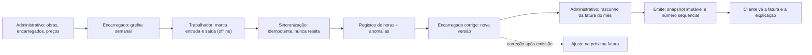
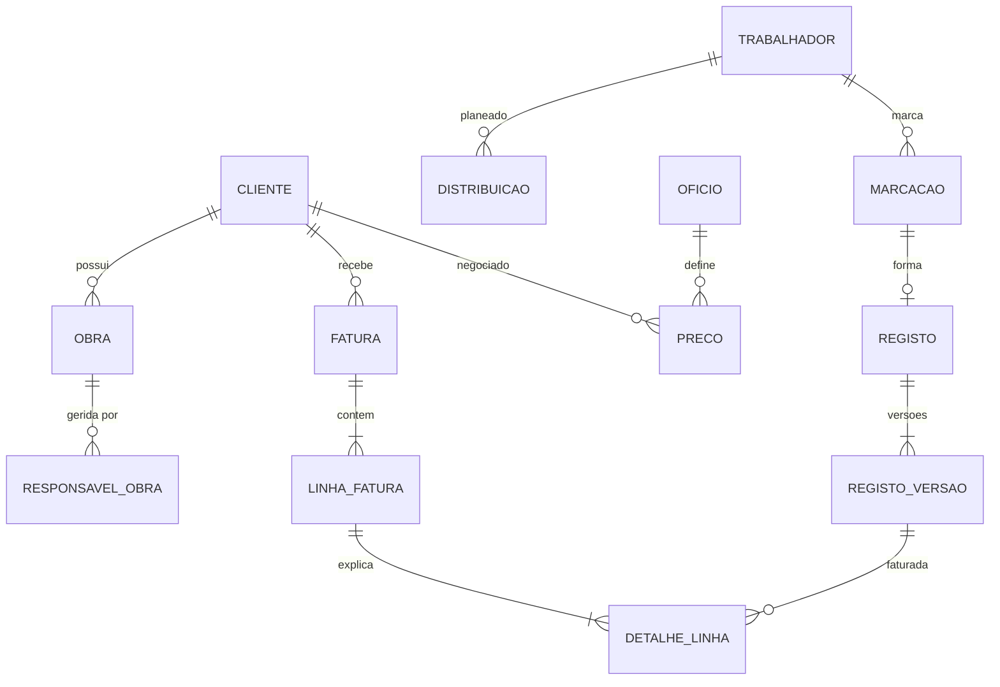

# Plano Conceitual v2 — Assiduidade e Faturação (multiempresa)

> Alinhado com o **enunciado oficial** (13 out 2026). Substitui o plano v1, que se baseava na proposta preliminar.
> A interface inspira-se na **Factorial** (relógio de ponto, grelha semanal, estado da equipa, caixa de pendências). Quando a Factorial e o enunciado divergem, **segue-se o enunciado**.
> Este documento não define tecnologias.

---

## 1. Princípios (o que guia todas as decisões)

1. **O dinheiro tem de bater certo hoje e daqui a dois anos.** Uma fatura emitida explica-se só com o que ficou guardado nela, sem recalcular nada.
2. **Facto ≠ correção ≠ fatura.** A marcação do telemóvel é um facto e nunca se altera. Uma correção cria uma nova versão do registo. A fatura guarda uma cópia (snapshot) da versão que usou.
3. **O que é planeado não é o que é faturado.** A grelha semanal diz onde o trabalhador *devia* estar. A fatura sai das marcações *reais*.
4. **Nunca rejeitar um facto que vem do terreno.** Uma marcação estranha é aceite e sinalizada para o encarregado resolver.
5. **Uma empresa nunca vê dados de outra.** O isolamento é imposto no banco, não apenas no código.
6. **Volume baixo, valores altos.** Privilegiar a correção e a rastreabilidade em vez do desempenho.

---

## 2. Perfis e permissões (só os 4 pedidos)

O login está fora de âmbito. Há um **seletor de empresa + "quem sou eu"** (como o seletor "ACME ▾" da Factorial). O servidor nunca confia no que o browser diz: o perfil é sempre lido do utilizador escolhido.

| Ação | Trabalhador | Encarregado | Administrativo | Cliente |
|---|:-:|:-:|:-:|:-:|
| Registar a própria entrada e saída | ✅ | | | |
| Ver as próprias horas e alertas | ✅ | | | |
| Distribuir trabalhadores (grelha) | | ✅ só nas suas obras | ✅ todas | |
| Corrigir registos de horas | | ✅ só nas suas obras | ✅ todas | |
| Definir o encarregado de cada obra | | | ✅ | |
| Definir preços por cliente | | | ✅ | |
| Gerar, verificar e emitir faturas | | | ✅ | |
| Ver uma fatura e a explicação dos valores | | | ✅ todas | ✅ só as suas e só emitidas |

---

## 3. Ecrãs (os 5 obrigatórios)

| # | Ecrã | Inspiração Factorial | Conteúdo |
|---|---|---|---|
| 1 | **Relógio de ponto** (telemóvel) | "Registar entrada" + "Selecionar projeto" | Botão grande Entrada/Saída; obra pré-preenchida pela grelha do dia (pode ser trocada); indicador "pendente de sincronização"; alerta "Esqueceu-se de registar a saída — contacte o seu encarregado"; lista das horas da semana |
| 2 | **Distribuição** (grelha semanal) | Página "Turnos" | Trabalhadores × dias; cada célula = obra (+ ofício, se diferente do habitual); "copiar semana anterior"; conflitos a vermelho que **nunca bloqueiam**; etiqueta informativa "horas extra" |
| — | **Estado da equipa + Pendências** (encarregado e administrativo) | "Estado da equipa" + "Requer a sua atenção" | Quem não marcou entrada, registos incompletos, marcações fora da distribuição, registos sem preço, correções que afetam faturas já emitidas |
| 3 | **Faturação mensal** | — | Gerar rascunho (cliente + mês) → verificar → emitir; os bloqueios aparecem antes da emissão |
| 4 | **Fatura + explicação** | — | Total → linhas (obra × ofício × preço) → registos → versões e marcações. Cada cêntimo é rastreável até à marcação original |

---

## 4. Fluxo ponta a ponta

---

## 5. Modelo de dados conceitual

Todas as tabelas têm `empresa_id`. As chaves estrangeiras incluem `empresa_id`, para que seja impossível ligar dados de duas empresas.

### 5.1 Organização e cadastros
| Entidade | Campos-chave | Notas |
|---|---|---|
| **Empresa** | id, nome, marca (nome/cor), fuso horário | O tenant. A marca serve para o whitelabel |
| **Utilizador** | id, empresa_id, nome, papel (trabalhador / encarregado / administrativo / cliente), trabalhador_id?, cliente_id? | Sem password (login fora de âmbito) |
| **Oficio** | id, empresa_id, nome, ativo | A lista é própria de cada empresa |
| **Trabalhador** | id, empresa_id, nome, oficio_habitual_id, ativo | |
| **Cliente** | id, empresa_id, nome, NIF, ativo | |
| **Obra** | id, empresa_id, cliente_id, nome, local, ativa | |
| **ResponsavelObra** | id, empresa_id, obra_id, encarregado_id, desde, até | Com datas de validade: sabe-se quem era responsável em cada data |

### 5.2 Planeamento
| Entidade | Campos-chave | Notas |
|---|---|---|
| **Distribuicao** (uma célula da grelha) | id, empresa_id, trabalhador_id, dia, obra_id, oficio_id?, alterado_por, alterado_em | Único por (trabalhador, dia). Sem `oficio_id` → usa o ofício habitual. Não se edita no passado. **Não fatura nada** |

### 5.3 Assiduidade (os factos)
| Entidade | Campos-chave | Notas |
|---|---|---|
| **Marcacao** | id (gerado no telemóvel), empresa_id, trabalhador_id, obra_id, tipo (entrada / saída), hora_aparelho, hora_recebida | **Imutável.** Um identificador repetido é ignorado (resolve a sincronização duplicada) |
| **Registo** (período trabalhado) | id, empresa_id, trabalhador_id, marcacao_entrada_id, marcacao_saida_id?, estado (aberto / incompleto / completo), versao_atual_id | Formado pelo par entrada → saída |
| **RegistoVersao** | id, empresa_id, registo_id, n.º, obra_id, oficio_id, inicio, fim, minutos, autor_id, motivo, criada_em | **Nunca se edita nem se apaga.** A versão 1 vem das marcações; cada correção do encarregado cria a versão N+1 com motivo |

**Anomalias** (calculadas, não guardadas): sem saída; marcação numa obra diferente da distribuição; desvio grande entre a hora do aparelho e a hora recebida; sem preço para o cliente × ofício nessa data.

### 5.4 Preços
| Entidade | Campos-chave | Notas |
|---|---|---|
| **Preco** | id, empresa_id, cliente_id, oficio_id, preco_hora_centimos, valido_de, valido_ate? | Sem sobreposição de vigências para o mesmo (cliente, ofício). **Um preço usado numa fatura emitida não se edita**: fecha-se a vigência e cria-se outra |

### 5.5 Faturação
| Entidade | Campos-chave | Notas |
|---|---|---|
| **Fatura** | id, empresa_id, cliente_id, mes, numero?, estado (rascunho / emitida), emitida_por, emitida_em, total_periodo, total_ajustes, total | O número é sequencial por empresa, atribuído **na emissão**, sem buracos. Uma fatura emitida é imutável |
| **LinhaFatura** | id, fatura_id, tipo (período / ajuste), obra_id, oficio_id, preco_id, preco_hora_centimos (cópia), minutos, valor_centimos, fatura_origem_id? | Agrupada por obra × ofício × preço. No ajuste, aponta para a fatura que está a corrigir |
| **DetalheLinha** (a explicação) | id, linha_id, registo_versao_id, sinal (+ / −), dia, trabalhador_nome, inicio, fim, minutos (cópias) | Mostra exatamente que versões de que registos formam a linha |

### 5.6 Auditoria
**EventoAuditoria**: empresa_id, utilizador_id, ação, entidade, entidade_id, antes, depois, quando. Só se acrescentam linhas.

---

## 6. Regras de cálculo

1. `minutos = fim − início`, ao minuto exato, sem arredondamento de tempos.
2. O turno conta para o **dia de início**, no fuso da empresa. Um turno que atravessa a meia-noite não é dividido.
3. **Preço** = o preço em vigor para (cliente da obra × ofício exercido) **na data de início** do turno.
4. **Ofício exercido** = o ofício indicado na correção do encarregado → o ofício da célula da grelha nesse dia → o ofício habitual.
5. **Linha** = Σ minutos por (obra, ofício, preço); `valor = arredondar_meio_acima(minutos × preço_hora_centimos ÷ 60)`. **Arredonda-se uma vez por linha**; o total é a soma das linhas.
6. Um preço que muda a meio do mês dá origem a duas linhas automaticamente, porque o preço faz parte do agrupamento.

### 6.1 O que entra no rascunho da fatura de um cliente para o mês M
- **Período:** a versão atual de cada registo completo das obras do cliente com dia ≤ fim de M que **ainda não tenha sido faturado**. Inclui registos de meses anteriores que chegaram tarde (sincronização offline) ou foram excluídos antes.
- **Ajustes:** cada registo já faturado cuja versão atual seja diferente da versão faturada entra como **−(versão faturada) + (versão atual)**. Isto cobre corretamente as mudanças de horas, de obra e de ofício, com o preço da data original. As linhas de ajuste referem a fatura de origem: *"Ajuste à fatura FT 2026/0007"*.
- **Total = período + ajustes = o valor em aberto.** Se o cliente já não tiver obras ativas, o administrativo pode gerar uma fatura só com os ajustes.

### 6.2 O que bloqueia a emissão
Registos **incompletos** ou **sem preço**. O administrativo resolve o problema (corrige o registo ou cria o preço) ou **exclui** o registo explicitamente; nesse caso, o registo passa para a fatura seguinte.

### 6.3 Emissão
Numa única operação atómica: atribui o número, copia preços e versões para as linhas e detalhes, e marca a fatura como imutável. Duas emissões em simultâneo não podem faturar o mesmo registo duas vezes.

---

## 7. Trabalho sem rede (offline)

- O telemóvel guarda as marcações numa **fila local**, cada uma com um identificador gerado no aparelho e a hora do aparelho.
- Ao sincronizar, o servidor aceita marcações **repetidas sem as duplicar**, em qualquer ordem e com atraso.
- O servidor **nunca rejeita** uma marcação. O que estiver errado (obra fora da distribuição, sem saída, relógio desviado) vira uma **anomalia** para o encarregado.
- Vale a **hora do aparelho**; a hora recebida no servidor fica guardada para auditoria e para detetar desvios.

---

## 8. Testes que provam o dinheiro

| Área | Teste |
|---|---|
| Cálculo | 08:00–17:00 = 540 min; o arredondamento ao cêntimo é feito por linha |
| Preço a meio do mês | Um turno antes e outro depois da mudança → duas linhas com preços diferentes |
| Ofício diferente | O preço segue o ofício exercido, não o habitual |
| Correção após emissão | A fatura emitida não muda; a fatura seguinte tem um ajuste −/+ correto e referencia a fatura original |
| Reprodutibilidade | Alterar preços e registos depois da emissão → a explicação da fatura antiga continua igual ao cêntimo |
| Offline | A mesma marcação enviada duas vezes → um único registo; uma marcação atrasada de um mês já faturado → entra na fatura seguinte |
| Bloqueios | Um registo sem preço ou incompleto impede a emissão até ser resolvido ou excluído |
| Concorrência | Duas emissões em simultâneo → um registo nunca é faturado duas vezes |
| Isolamento | A empresa B nunca vê nem altera dados da empresa A, nem por identificador direto |
| Permissões | O encarregado não corrige em obras de outros; o cliente não vê rascunhos nem faturas de outros clientes |

---

## 9. Dados de exemplo
Duas empresas, cada uma com ofícios próprios, dois clientes, três obras, encarregados, cerca de oito trabalhadores e um mês de marcações. Os dados incluem de propósito:
- uma mudança de preço a meio do mês;
- um trabalhador a exercer outro ofício;
- uma marcação fora da distribuição;
- uma saída esquecida;
- uma fatura já emitida com uma correção posterior (para mostrar o ajuste).

---

## 10. Fora de âmbito
PDF e email; deploy e infraestrutura; login; papéis extra; agente de IA, programação automática, ausências e despesas (presentes na Factorial, mas não pedidos); horas extra e noturnas no preço; pagamentos; processamento salarial.

> **AT / SAF-T / IVA (frase para o DECISOES.md):** a Fatura emitida passaria a ser registada num software certificado. A numeração, o hash e o ATCUD seriam atribuídos na emissão, e os ajustes seriam emitidos como notas de crédito/débito que referenciam a fatura original. O modelo já guarda essa referência (`fatura_origem_id`).

---

## 11. Registo de decisões (base do DECISOES.md)

| Tema | Decisão |
|---|---|
| Hora válida | A do aparelho; a do servidor fica guardada e desvios grandes são sinalizados |
| Saída esquecida | O registo fica incompleto; o trabalhador vê o alerta; **só o encarregado corrige** (segue o enunciado, não a Factorial) |
| Duplicação na sincronização | Identificador gerado no aparelho; uma marcação repetida é ignorada |
| Obra fora da distribuição | Aceite e sinalizada; a fatura segue a marcação real |
| Pausas | Uma saída seguida de nova entrada; sem desconto automático |
| Meia-noite | O turno conta para o dia de início |
| Arredondamento | Tempo ao minuto exato; valor arredondado ao cêntimo uma vez por linha |
| Distribuição | Grelha semanal trabalhador × dia → obra (+ ofício); sem horários e sem "publicar"; conflitos nunca bloqueiam |
| Âmbito do encarregado | Trabalhadores livres ou das suas obras; nunca obras de outros |
| Ofício diferente | Indicado na célula da grelha ou na correção; o preço segue o ofício exercido |
| Passado | A grelha não se edita no passado; corrige-se nos registos |
| Responsável da obra | Atribuição com datas de validade |
| Preço | Cliente × ofício × vigência; vale o preço da data de início do turno |
| Preço em falta | Bloqueia a emissão |
| Preço já faturado | Não se edita; cria-se uma nova vigência |
| Horas extra / noturnas | Não afetam o preço; a etiqueta é só informativa |
| Unidade de faturação | Uma fatura por cliente e por mês civil, com detalhe por obra × ofício × preço |
| Correção após emissão | Ajuste −/+ na fatura seguinte, com referência à fatura de origem; cada fatura apresenta o valor em aberto |
| Registos tardios | Entram na fatura seguinte |
| Rascunho | Recalculável; só a emissão congela |
| Numeração | Sequencial por empresa, atribuída na emissão |
| "Acompanhar o faturado" | Lista e histórico das faturas; sem pagamentos |
| Reprodutibilidade | Snapshot das versões e preços em cada linha |
| Visibilidade do cliente | Só faturas emitidas, com nomes e horas (necessário para explicar os valores) |
| Trabalhador | Vê as suas horas; não corrige |
| Multiempresa | Isolamento total; o mesmo cliente ou trabalhador em duas empresas são registos independentes |

---

## 12. Ordem de execução (1 semana)

| Dia | Entrega | Critério |
|---|---|---|
| 1 | Esqueleto, arranque com um comando, modelo de dados + isolamento, dados de exemplo | Sobe com um comando; existe um teste de isolamento |
| 2 | Marcações + sincronização idempotente + registos e versões | Testes de duplicação e de chegada tardia |
| 3 | Preços + cálculo + rascunho e emissão da fatura | Testes de preço a meio do mês, ofício e arredondamento |
| 4 | Ajustes pós-emissão + ecrã de explicação da fatura | Teste de reprodutibilidade |
| 5 | Grelha de distribuição + estado da equipa + pendências | Permissões de encarregado e de cliente testadas |
| 6 | Ecrã do telemóvel (offline) + acabamentos | Fluxo de demonstração completo |
| 7 | README, DECISOES.md (máx. 2 páginas), revisão do que falta | Documentação final |

> [!IMPORTANT]
> A prioridade é o **caminho do dinheiro** (dias 2 a 4). Se faltar tempo, cortam-se acabamentos da grelha e do telemóvel, nunca os testes de faturação. O que ficar por fazer é documentado no DECISOES.md.
